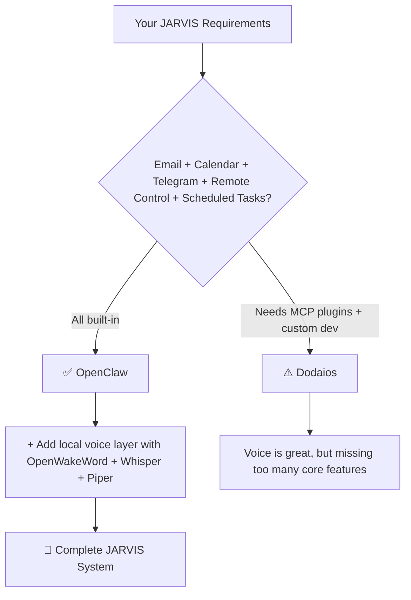
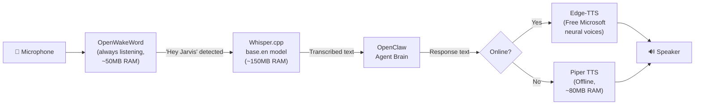
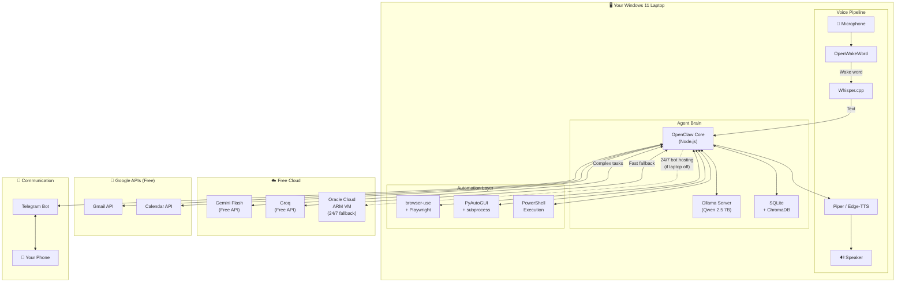
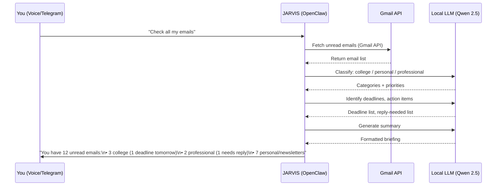
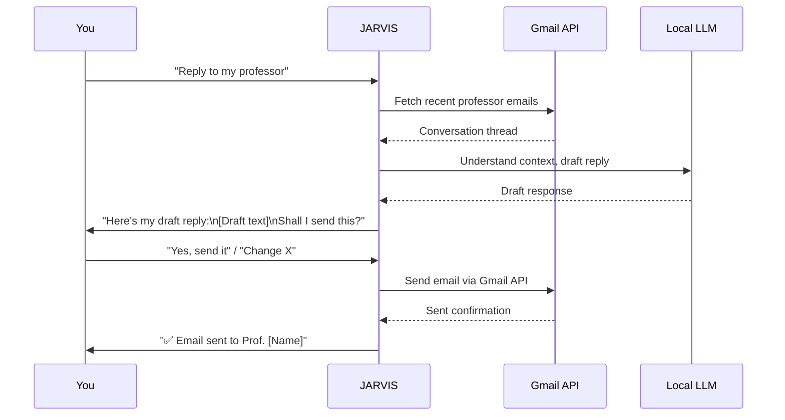
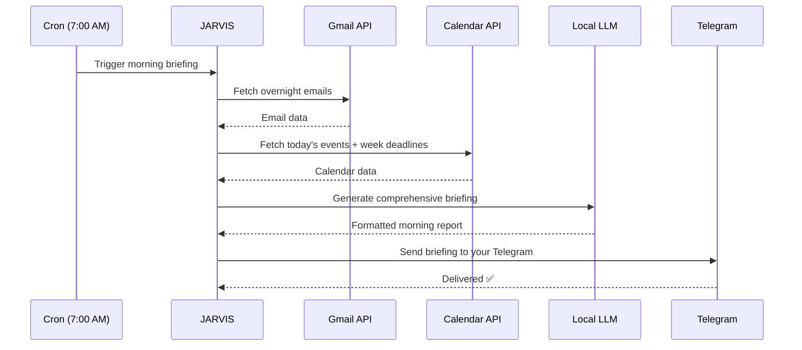
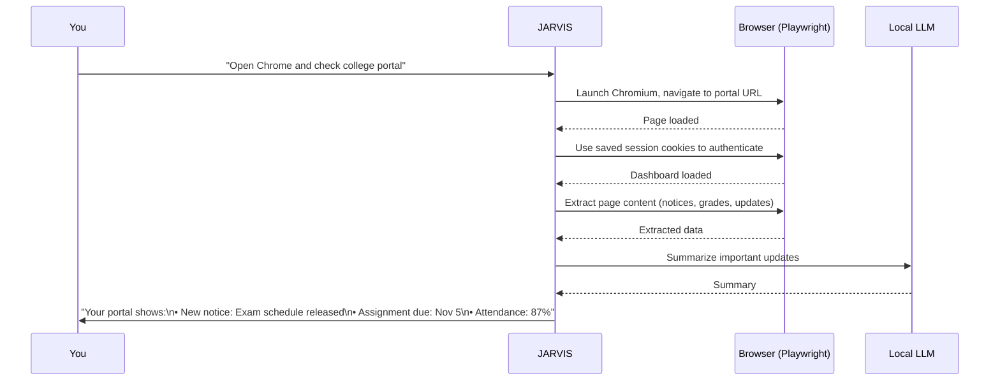

# 🤖 Project JARVIS — Complete Technical Strategy

> **Mission:** Build the most capable personal AI assistant with ₹0 recurring cost, using open-source software, student benefits, free cloud resources, and local AI models.
>
> **Status:** Research & Planning Complete — Ready for Implementation

---

## Table of Contents

1. [Repository Comparison: Dodaios vs OpenClaw](#1-repository-comparison-dodaios-vs-openclaw)
2. [Feature-by-Feature Evaluation Matrix](#2-feature-by-feature-evaluation-matrix)
3. [Strategic Recommendation](#3-strategic-recommendation)
4. [Local AI Stack for Your Hardware](#4-local-ai-stack-for-your-hardware)
5. [Free Resources & Student Benefits](#5-free-resources--student-benefits)
6. [Complete System Architecture](#6-complete-system-architecture)
7. [Module-by-Module Implementation Plan](#7-module-by-module-implementation-plan)
8. [JARVIS Capabilities Mapping](#8-jarvis-capabilities-mapping)
9. [Security Architecture](#9-security-architecture)
10. [Phased Implementation Roadmap](#10-phased-implementation-roadmap)
11. [Risk Analysis & Mitigations](#11-risk-analysis--mitigations)

---

## 1. Repository Comparison: Dodaios vs OpenClaw

### 1.1 Dodaios (formerly "Personal Jarvis")

| Attribute | Details |
|---|---|
| **GitHub** | `Dodaios/Dodaios` |
| **Stars** | ~260+ |
| **License** | Apache 2.0 (MIT pre-v1.6) |
| **Language** | TypeScript/Rust core |
| **First Release** | July 2026 |
| **Rebrand** | October 2026 (from "Personal Jarvis") |
| **Activity** | Frequent daily commits, active PRs |

**Core Philosophy:** Desktop-first "Agent Operating System". Tightly coupled to your local machine with a visual workspace interface (split-pane Agentic IDE, "Orb" overlay for voice, "Verse" visual environment).

**Key Strengths:**
- Voice-first interaction with custom wake-word and on-screen Orb overlay
- Offline speech recognition built-in
- Multi-agent orchestration (Claude Code, Codex, OpenCode in live panes)
- OS-native credential manager (not plaintext config files)
- Single-command PowerShell install
- 40+ plugins and MCP server ecosystem
- Local-first: Ollama support for fully offline operation
- Built-in local wikis, memory maps, visual artifact boards

**Key Limitations:**
- Relatively new project (~260 stars, ~4 months old)
- Smaller community and ecosystem
- Primarily focused on coding agent workflows
- Email/Calendar integrations exist through MCP plugins but aren't first-class features
- No native messaging app integration (Telegram/WhatsApp)
- No companion mobile app

---

### 1.2 OpenClaw

| Attribute | Details |
|---|---|
| **GitHub** | `openclaw/openclaw` |
| **Stars** | ~400,000 |
| **License** | MIT |
| **Language** | TypeScript/Node.js core |
| **First Release** | November 2025 |
| **Activity** | Massively active — one of the fastest-growing repos in GitHub history |

**Core Philosophy:** Chat-first autonomous agent platform. Lives inside your messaging apps (Telegram, WhatsApp, Discord, Signal). Optimized for "actually doing things" asynchronously, 24/7.

**Key Strengths:**
- Native Telegram, WhatsApp, Discord, Signal, Slack, iMessage integration
- Email triage, drafting, daily digest automation built-in
- Google Calendar AI scheduling, morning briefings
- Mobile companion apps (Android, Wear OS) with push-to-talk and QR pairing
- Massive plugin ecosystem via ClawHub (thousands of community skills)
- Full local LLM support via Ollama (zero API cost mode)
- MCP support for developer tools (GitHub, Linear, Notion, 1Password)
- Multi-model routing (OpenRouter, Cloudflare AI Gateway, LiteLLM)
- Docker self-hosting or managed cloud options
- 400K+ stars, massive community, enterprise-grade maturity

**Key Limitations:**
- Chat-first interface (no visual desktop Orb/voice overlay)
- Voice support through messaging voice notes, not always-on wake-word
- Credential management via config/env files (less secure than OS credential manager)
- Server-oriented architecture (Docker/always-on process) vs. desktop app
- Setup complexity is higher for full self-hosted deployment
- Some premium features gated behind managed cloud offering

---

## 2. Feature-by-Feature Evaluation Matrix

> **Rating Scale:**
> 1. ✅ Fully implemented
> 2. 🔌 Available through official integration
> 3. ⚙️ Requires configuration
> 4. 🔧 Requires additional development
> 5. ❌ Not supported

| Feature | Dodaios | OpenClaw | Notes |
|---|---|---|---|
| **Windows 11 Compatibility** | ✅ Fully implemented | ✅ Fully implemented | Both run on Windows. Dodaios: native installer. OpenClaw: Docker or Node.js. |
| **Voice Interaction** | ✅ Fully implemented | ⚙️ Requires configuration | Dodaios has native wake-word + Orb UI. OpenClaw relies on voice notes via Telegram/WhatsApp or companion app push-to-talk. |
| **Wake-Word Support** | ✅ Fully implemented | 🔧 Requires additional dev | Dodaios has built-in custom wake-phrase. OpenClaw would need an external wake-word listener (OpenWakeWord) piped into its API. |
| **Browser Automation** | ✅ Fully implemented | ✅ Fully implemented | Both support computer-use / browser control. Dodaios via built-in agent skills. OpenClaw via browser execution skills. |
| **Desktop Automation** | ✅ Fully implemented | 🔌 Available via integration | Dodaios is a desktop-native agent OS. OpenClaw's desktop control is primarily through shell commands and skills. |
| **Terminal Execution** | ✅ Fully implemented | ✅ Fully implemented | Both can execute shell commands natively. |
| **Gmail Integration** | 🔌 Available via MCP plugin | ✅ Fully implemented | OpenClaw has first-class email triage, drafting, digests. Dodaios via MCP email servers. |
| **Google Calendar** | 🔌 Available via MCP plugin | ✅ Fully implemented | OpenClaw has native scheduling, briefings, conflict detection. Dodaios via MCP. |
| **Telegram Integration** | 🔧 Requires additional dev | ✅ Fully implemented | OpenClaw's primary interface IS Telegram/WhatsApp. Dodaios has no native messaging app support. |
| **Remote Laptop Control** | 🔧 Requires additional dev | ✅ Fully implemented | OpenClaw: send commands via Telegram from phone. Dodaios: desktop-only, would need custom tunnel. |
| **Persistent Memory** | ✅ Fully implemented | ✅ Fully implemented | Dodaios: local wikis, memory maps, artifacts. OpenClaw: conversation memory, context persistence. |
| **Multiple Specialized Agents** | ✅ Fully implemented | ✅ Fully implemented | Both support multi-agent orchestration. Dodaios: coding agent panes. OpenClaw: skill-based agents. |
| **Scheduled Tasks** | 🔌 Available via plugin | ✅ Fully implemented | OpenClaw has built-in cron-like routines. Dodaios would need plugin/MCP configuration. |
| **Background Execution** | ⚙️ Requires configuration | ✅ Fully implemented | OpenClaw runs as a daemon/Docker service 24/7. Dodaios is primarily a foreground desktop app. |
| **Local LLM Support** | ✅ Fully implemented | ✅ Fully implemented | Both support Ollama for fully offline, zero-cost inference. |
| **Cloud Model Integration** | ✅ Fully implemented | ✅ Fully implemented | Both support OpenAI, Claude, Gemini, OpenRouter, etc. |
| **MCP Support** | ✅ Fully implemented | ✅ Fully implemented | Both have robust MCP ecosystems. Dodaios: 40+ plugins. OpenClaw: ClawHub thousands. |
| **Security & Permissions** | ✅ Fully implemented | ⚙️ Requires configuration | Dodaios uses OS-native credential manager. OpenClaw uses env vars/config files — more manual security hardening needed. |
| **API Compatibility** | ✅ Fully implemented | ✅ Fully implemented | Both expose APIs. OpenClaw has a richer REST/webhook ecosystem. |
| **Ease of Customization** | ⚙️ Requires configuration | ✅ Fully implemented | OpenClaw's ClawHub makes adding skills trivial. Dodaios customization is more developer-oriented. |
| **Resource Consumption** | ⚙️ Moderate | ⚙️ Moderate | Both are Node/TS-based. OpenClaw + Docker adds overhead. Dodaios has Rust core (lighter). |
| **Community & Maintenance** | 🔧 Small but active | ✅ Massive & thriving | 260 vs 400,000 stars. OpenClaw has orders of magnitude more community resources. |
| **Installation Complexity** | ✅ Simple (one command) | ⚙️ Moderate (Docker/Node) | Dodaios: PowerShell one-liner. OpenClaw: requires Docker or manual Node.js setup with Telegram bot tokens. |

---

## 3. Strategic Recommendation

> [!IMPORTANT]
> ### 🏆 Recommended: OpenClaw as the Core Platform
>
> For your specific JARVIS use cases (email management, calendar briefings, Telegram control, remote access, scheduled automation), **OpenClaw is the clear winner**. It has every critical integration you need as first-class features, a massive community for support, and proven production stability.

### Why OpenClaw wins for YOUR requirements:



### The Hybrid Strategy

Use **OpenClaw** as the brain and automation backbone, then layer on **Dodaios-inspired voice components** as a separate local voice frontend:

| Layer | Technology | Purpose |
|---|---|---|
| 🧠 **Brain** | OpenClaw (self-hosted) | Agent orchestration, email, calendar, Telegram, scheduling |
| 🎤 **Ears** | OpenWakeWord + Whisper.cpp | Wake-word detection + speech-to-text |
| 🗣️ **Voice** | Piper TTS + Edge-TTS (fallback) | Text-to-speech output |
| 🌐 **Browser** | browser-use + Playwright | AI-driven browser automation |
| 💾 **Memory** | SQLite + ChromaDB | Persistent context and semantic search |
| 🤖 **Local LLM** | Ollama (Qwen 2.5 7B / Phi-4-mini) | Zero-cost AI inference |
| ☁️ **Cloud LLM** | Gemini Flash (free) + Groq (free) | Heavy tasks when needed |
| 📱 **Remote** | Telegram Bot | Control your laptop from anywhere |

---

## 4. Local AI Stack for Your Hardware

> [!NOTE]
> **Your System:** Intel i7 11th Gen • 16 GB RAM • No GPU • 512 GB SSD
>
> With ~8 GB available for model inference (after OS + apps), you can run excellent 3B–8B models.

### 4.1 Inference Engine

| Engine | Recommendation | Why |
|---|---|---|
| **Ollama** | ✅ **Primary** | Dead-simple setup on Windows. `winget install Ollama.Ollama` and go. Handles model management, API server, quantization automatically. |
| **llama.cpp** | 🔄 Fallback | More control, but Ollama wraps it already. Use directly only if you need custom GGUF models or Vulkan iGPU offload. |

### 4.2 Model Selection Matrix

| Model | Size (Q4) | RAM Usage | Speed (i7 11th) | Best For | Function Calling |
|---|---|---|---|---|---|
| **Qwen 2.5 7B Instruct** | ~4.5 GB | ~5.5 GB | 8–12 tok/s | ⭐ Primary brain (coding, logic, JSON) | ✅ Yes |
| **Phi-4-mini (3.8B)** | ~2.3 GB | ~3 GB | 20–35 tok/s | ⚡ Fast tasks, RAG, quick answers | ✅ Yes |
| **Llama 3.2 3B** | ~2 GB | ~2.5 GB | 25–35 tok/s | Quick classification, routing | ✅ Yes |
| **Qwen 2.5 Coder 7B** | ~4.5 GB | ~5.5 GB | 8–12 tok/s | Code generation specifically | ✅ Yes |

> [!TIP]
> **Recommended Setup:** Run **Phi-4-mini** as your default fast-response model and **Qwen 2.5 7B** for complex reasoning tasks. Ollama can swap models on demand — only one loads into RAM at a time.
>
> **Crucial Settings:**
> - Use `Q4_K_M` quantization exclusively
> - Set `num_ctx` to 4096 (not 32K default) to save RAM
> - Close Chrome/Electron apps during heavy inference

### 4.3 Voice Pipeline



| Component | Tool | RAM | Speed | Notes |
|---|---|---|---|---|
| **Wake Word** | OpenWakeWord | ~50 MB | Real-time | Apache 2.0. Train custom "Hey Jarvis" via free Colab notebook. |
| **Speech-to-Text** | whisper.cpp (base.en) | ~150 MB | Real-time | Standalone `.exe` on Windows. No Python needed. High accuracy. |
| **TTS (Online)** | edge-tts | ~10 MB | Instant | Free Microsoft neural voices. Studio quality. Needs internet. |
| **TTS (Offline)** | Piper TTS | ~80 MB | Instant | ONNX models. Works on CPU. Good quality. Fully offline. |
| **TTS (Premium)** | Kokoro-82M | ~160 MB | Fast | Apache 2.0. 82M params. Near-commercial quality on CPU. |

### 4.4 Cloud AI Fallback (Free Tiers)

When local models aren't enough for complex tasks:

| Provider | Free Tier | Best For | Credit Card? |
|---|---|---|---|
| **Google Gemini API** (AI Studio) | Gemini Flash: generous RPM/TPM/RPD | Heavy reasoning, long documents | No |
| **Groq** | Llama 3.3 70B: ~30 RPM, 1K–14K RPD | Fast cloud inference for complex tasks | No |
| **Cloudflare Workers AI** | 10,000 Neurons/day | Lightweight serverless inference | No |
| **Hugging Face Inference** | Rate-limited free tier | Specialized models, embeddings | No |

> [!WARNING]
> **Google Gemini Free Tier:** Your inputs/outputs may be used for training. Do NOT send sensitive personal data (emails, passwords) through the free Gemini API. Use local Ollama models for private data processing.

---

## 5. Free Resources & Student Benefits

### 5.1 GitHub Student Developer Pack

> Apply at [education.github.com](https://education.github.com) with your NIT Jalandhar `.ac.in` email or college ID.

| Benefit | Value | Use Case for JARVIS |
|---|---|---|
| **GitHub Copilot** | Free (~\$120/yr saved) | AI-assisted coding during development |
| **Microsoft Azure for Students** | \$100 credits (no CC) | Host OpenClaw backend, test cloud services |
| **JetBrains IDEs** | Free professional licenses | PyCharm, WebStorm for development |
| **Namecheap** | Free `.me` domain (1 year) | Custom domain for your JARVIS API |
| **MongoDB Atlas** | Credits | Database for conversation memory |

### 5.2 Oracle Cloud Always Free Tier

| Resource | Spec | Use Case |
|---|---|---|
| **ARM Ampere A1** | 2 OCPUs, 12 GB RAM (reduced from 4/24) | Run Ollama remotely for 24/7 Telegram bot backend |
| **Block Storage** | 200 GB | Model storage |
| **Object Storage** | 20 GB | Backup / file storage |
| **Outbound Data** | 10 TB/month | API traffic |

> [!CAUTION]
> **India (Mumbai) Region:** "Out of host capacity" errors are extremely common. Try off-peak hours (2–5 AM IST), retry scripts, or temporarily upgrade to Pay-As-You-Go (still free within limits).
>
> **Card Required:** You need an international-enabled debit/credit card. Enable international transactions via your bank app before signing up.
>
> **Performance:** Expect 3–5 tok/s with Llama 3.1 8B on 2 ARM OCPUs. Usable for async Telegram bot responses, NOT for real-time voice.

### 5.3 Other Free Resources

| Service | Free Tier | Purpose |
|---|---|---|
| **Gmail API** | Free (OAuth, personal use) | Read/send emails |
| **Google Calendar API** | Free (10K req/min per project) | Calendar management |
| **Telegram Bot API** | Completely free, unlimited | Primary remote interface |
| **Cloudflare Workers** | 100K requests/day | Serverless API endpoints |
| **Railway.app** | \$5/month free tier | Lightweight bot hosting |
| **Render.com** | Free tier web services | Webhook endpoints |

### 5.4 Free Tier Cost Summary

| Component | Monthly Cost |
|---|---|
| Local Ollama inference | ₹0 (your hardware) |
| Gemini Flash API | ₹0 (free tier) |
| Groq API | ₹0 (free tier) |
| Gmail API | ₹0 (personal OAuth) |
| Calendar API | ₹0 (free tier) |
| Telegram Bot | ₹0 (free forever) |
| Oracle Cloud ARM | ₹0 (always free) |
| OpenClaw | ₹0 (MIT license, self-hosted) |
| **Total Monthly** | **₹0** |

---

## 6. Complete System Architecture



---

## 7. Module-by-Module Implementation Plan

### Module 1: Core Brain (OpenClaw Self-Hosted)

```
Priority: 🔴 CRITICAL — Build first
Estimated time: 2–3 days
```

| Step | Action |
|---|---|
| 1 | Install Node.js 20+ LTS and Docker Desktop on Windows |
| 2 | Clone and configure OpenClaw locally |
| 3 | Set up Ollama with `qwen2.5:7b-instruct-q4_K_M` |
| 4 | Configure OpenClaw to use Ollama as the default model provider |
| 5 | Test basic chat interaction via CLI |
| 6 | Add Gemini Flash and Groq as fallback cloud providers |

### Module 2: Telegram Bot Interface

```
Priority: 🔴 CRITICAL — Your primary remote interface
Estimated time: 1 day
```

| Step | Action |
|---|---|
| 1 | Create a Telegram bot via @BotFather |
| 2 | Configure OpenClaw's Telegram channel (grammY integration) |
| 3 | Set up long-polling mode (no webhook needed for local hosting) |
| 4 | Test sending commands from your phone |
| 5 | Enable voice message processing (Telegram voice notes → STT) |

### Module 3: Gmail & Calendar Integration

```
Priority: 🔴 CRITICAL — Core JARVIS functionality
Estimated time: 2–3 days
```

| Step | Action |
|---|---|
| 1 | Create a Google Cloud project (free) |
| 2 | Enable Gmail API + Calendar API |
| 3 | Set up OAuth 2.0 consent screen (Testing mode) |
| 4 | Generate OAuth credentials (Desktop App type) |
| 5 | Install and configure OpenClaw's email skill |
| 6 | Build custom "morning briefing" routine (email + calendar + summary → Telegram) |
| 7 | Build "email reply" workflow with approval step |

> [!NOTE]
> **OAuth Token Refresh:** In "Testing" mode, tokens expire every 7 days. To avoid manual re-auth, set your app to "In Production" status. Since you're the only user, Google verification isn't required.

### Module 4: Voice Interface (Local)

```
Priority: 🟡 HIGH — The "JARVIS feel"
Estimated time: 3–4 days
```

| Step | Action |
|---|---|
| 1 | Install OpenWakeWord (Python, pip install openwakeword) |
| 2 | Train custom "Hey Jarvis" wake word (free Google Colab notebook) |
| 3 | Install whisper.cpp (download pre-built Windows `.exe`) |
| 4 | Download `base.en` model (~150 MB) |
| 5 | Install Piper TTS + download English voice model |
| 6 | Install edge-tts as premium online fallback |
| 7 | Build a Python bridge script: Mic → OpenWakeWord → Whisper → OpenClaw API → TTS → Speaker |
| 8 | Create a Windows startup shortcut for background operation |

### Module 5: Browser Automation

```
Priority: 🟡 HIGH — College portal, web tasks
Estimated time: 2–3 days
```

| Step | Action |
|---|---|
| 1 | Install Playwright (`pip install playwright && playwright install chromium`) |
| 2 | Install browser-use (`pip install browser-use`) |
| 3 | Configure OpenClaw browser skill with Playwright MCP server |
| 4 | Build college portal login automation (secure session cookie management) |
| 5 | Test natural language browser commands |

### Module 6: Desktop Automation

```
Priority: 🟢 MEDIUM
Estimated time: 1–2 days
```

| Step | Action |
|---|---|
| 1 | Configure OpenClaw's shell execution capabilities |
| 2 | Build PowerShell automation scripts (app launching, file management) |
| 3 | Optionally add PyAutoGUI for GUI automation (clicking, typing) |
| 4 | Set up security sandbox (whitelist allowed commands) |

### Module 7: Scheduled Routines

```
Priority: 🟢 MEDIUM
Estimated time: 1–2 days
```

| Step | Action |
|---|---|
| 1 | Configure OpenClaw's built-in cron scheduler |
| 2 | Create "Morning Briefing" routine (7:00 AM daily) |
| 3 | Create "Email Digest" routine (9:00 AM, 6:00 PM) |
| 4 | Create "Deadline Reminder" routine (checks calendar every 2 hours) |
| 5 | All outputs delivered via Telegram |

### Module 8: Persistent Memory & RAG

```
Priority: 🟢 MEDIUM
Estimated time: 2–3 days
```

| Step | Action |
|---|---|
| 1 | Set up SQLite database for conversation history |
| 2 | Install ChromaDB for vector-based semantic memory |
| 3 | Configure OpenClaw to persist context across sessions |
| 4 | Build personal knowledge base (college deadlines, contacts, preferences) |
| 5 | Index important emails and calendar events for retrieval |

---

## 8. JARVIS Capabilities Mapping

### "Jarvis, check all my emails."



### "Jarvis, reply to my professor."



### "Jarvis, prepare my morning briefing."



### "Jarvis, open Chrome and check my college portal."



---

## 9. Security Architecture

> [!CAUTION]
> Your JARVIS will have access to your email, calendar, browser sessions, and system terminal. Security is non-negotiable.

### 9.1 Credential Management

| Secret | Storage | Method |
|---|---|---|
| Gmail OAuth tokens | OS Credential Manager | `keyring` Python library |
| Telegram Bot Token | `.env` file (600 permissions) | Never commit to git |
| Ollama API | localhost only (127.0.0.1:11434) | No external exposure |
| Google API keys | OS Credential Manager | `keyring` library |
| College portal password | OS Credential Manager | Never stored in plaintext |

### 9.2 Execution Sandboxing

| Action Type | Security Level | Implementation |
|---|---|---|
| Read email | ✅ Auto-approved | No confirmation needed |
| Send email | ⚠️ Requires approval | Telegram confirmation button |
| Run shell command | ⚠️ Requires approval | Command whitelist + confirmation |
| Delete files | 🛑 Blocked by default | Manual override only |
| Install software | 🛑 Blocked by default | Manual override only |
| Browser actions | ⚠️ Sandboxed | Playwright in isolated profile |

### 9.3 Network Security

- Ollama runs on `localhost:11434` — never expose to 0.0.0.0
- OpenClaw API behind localhost-only access
- Telegram long-polling (no inbound webhook, no open ports)
- All Google API calls via HTTPS with OAuth 2.0
- If using Oracle Cloud: VCN Security List restricts inbound to SSH only

---

## 10. Phased Implementation Roadmap

```mermaid
flowchart LR
    subgraph P1["Phase 1: Foundation\n(Week 1)"]
        A1["Install Ollama\n+ Qwen 2.5 7B"]
        A2["Set up OpenClaw\nlocally"]
        A3["Create Telegram\nBot"]
        A4["Basic chat\nworking"]
    end

    subgraph P2["Phase 2: Productivity\n(Week 2)"]
        B1["Gmail API\nintegration"]
        B2["Calendar API\nintegration"]
        B3["Morning briefing\nroutine"]
        B4["Email reply\nworkflow"]
    end

    subgraph P3["Phase 3: Voice\n(Week 3)"]
        C1["OpenWakeWord\nsetup"]
        C2["Whisper.cpp\ninstall"]
        C3["Piper TTS\nsetup"]
        C4["Voice bridge\nscript"]
    end

    subgraph P4["Phase 4: Automation\n(Week 4)"]
        D1["Browser\nautomation"]
        D2["College portal\nscripts"]
        D3["Desktop\nautomation"]
        D4["Scheduled\ntasks"]
    end

    subgraph P5["Phase 5: Polish\n(Week 5+)"]
        E1["RAG memory\nsystem"]
        E2["Oracle Cloud\n24/7 fallback"]
        E3["Custom skills\n& refinement"]
        E4["Security\nhardening"]
    end

    P1 --> P2 --> P3 --> P4 --> P5
```



### Time Estimates Summary

| Phase | Duration | Dependencies |
|---|---|---|
| Phase 1: Foundation | 3–4 days | None |
| Phase 2: Productivity | 4–5 days | Phase 1 |
| Phase 3: Voice | 3–4 days | Phase 1 |
| Phase 4: Automation | 3–5 days | Phase 1 |
| Phase 5: Polish | Ongoing | All phases |
| **Total MVP** | **~3–4 weeks** | — |

---

## 11. Risk Analysis & Mitigations

| Risk | Severity | Probability | Mitigation |
|---|---|---|---|
| **16 GB RAM too tight for Ollama + OpenClaw + Chrome** | 🟡 Medium | 🟡 Medium | Use Phi-4-mini (3.8B) as default. Load Qwen 7B only for complex tasks. Close Chrome during inference. Set `num_ctx: 4096`. |
| **CPU inference too slow for real-time voice** | 🟡 Medium | 🟡 Medium | Use Phi-4-mini for voice interactions (20–35 tok/s). Route complex queries to free Groq API (Llama 70B at cloud speed). |
| **Oracle Cloud ARM instance unavailable in India** | 🟠 High | 🟠 High | Retry at off-peak hours (2–5 AM). Use local-first architecture so Oracle is optional, not critical. |
| **Google OAuth tokens expiring every 7 days** | 🟡 Medium | 🟡 Medium | Set OAuth app to "In Production" (no verification needed for single-user personal app). |
| **Free API rate limits hit during heavy use** | 🟢 Low | 🟡 Medium | Implement tiered routing: local Ollama → Groq → Gemini. Cache responses. Use exponential backoff. |
| **Gemini free tier uses your data for training** | 🟠 High | ✅ Certain | NEVER send private emails/passwords via Gemini. Use local Ollama for all private data. Only use Gemini for general tasks. |
| **OpenClaw breaking changes (fast-moving project)** | 🟡 Medium | 🟡 Medium | Pin to a stable release version. Follow release channels. Don't use dev/bleeding-edge. |
| **Power outage / laptop shutdown kills JARVIS** | 🟡 Medium | 🟡 Medium | Phase 5: Oracle Cloud fallback for Telegram bot. Local: Windows Task Scheduler auto-restart on boot. |

---

## Appendix A: Complete Software Stack

| Layer | Component | Source | License |
|---|---|---|---|
| **Agent Core** | OpenClaw | github.com/openclaw/openclaw | MIT |
| **LLM Inference** | Ollama | ollama.com | MIT |
| **Primary Model** | Qwen 2.5 7B Instruct | Alibaba (HuggingFace) | Apache 2.0 |
| **Fast Model** | Phi-4-mini (3.8B) | Microsoft (HuggingFace) | MIT |
| **Wake Word** | OpenWakeWord | github.com/dscripka/openWakeWord | Apache 2.0 |
| **STT** | whisper.cpp | github.com/ggerganov/whisper.cpp | MIT |
| **TTS (Offline)** | Piper TTS | github.com/rhasspy/piper | MIT |
| **TTS (Online)** | edge-tts | github.com/rany2/edge-tts | GPL-3.0 |
| **TTS (Premium)** | Kokoro-82M | HuggingFace | Apache 2.0 |
| **Browser Auto** | browser-use + Playwright | github.com/browser-use | MIT / Apache |
| **Vector DB** | ChromaDB | github.com/chroma-core/chroma | Apache 2.0 |
| **Database** | SQLite | sqlite.org | Public Domain |
| **Telegram** | grammY | grammy.dev | MIT |
| **Gmail/Cal** | Google APIs | cloud.google.com | Apache 2.0 client |
| **Containerization** | Docker Desktop | docker.com | Free for personal use |

## Appendix B: Quick-Start Commands (Reference Only — Do Not Execute Yet)

```powershell
# Phase 1 installation commands (for reference when ready)

# 1. Install Ollama
winget install Ollama.Ollama

# 2. Pull models
ollama pull qwen2.5:7b-instruct-q4_K_M
ollama pull phi4-mini

# 3. Install Python tools
pip install openwakeword edge-tts browser-use chromadb keyring

# 4. Download whisper.cpp Windows binary
# → github.com/ggerganov/whisper.cpp/releases

# 5. Download Piper TTS Windows binary
# → github.com/rhasspy/piper/releases
```

---

> [!IMPORTANT]
> ### Next Steps
> 1. **Review this strategy** and confirm the OpenClaw + local voice hybrid approach
> 2. **Apply for GitHub Student Developer Pack** with your NIT Jalandhar email
> 3. **Sign up for free API keys**: Gemini (AI Studio), Groq, Cloudflare Workers AI
> 4. **Create a Telegram bot** via @BotFather (takes 2 minutes)
> 5. When ready, say **"Start Phase 1"** and I'll guide you through implementation step-by-step
